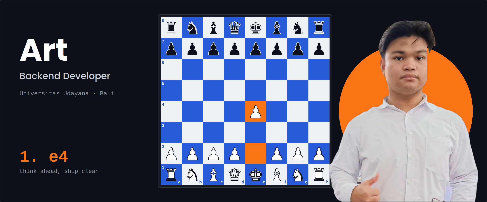

Informatics '26 at Udayana University &nbsp;&middot;&nbsp; Backend &amp; Systems Engineer &nbsp;&middot;&nbsp; Go Enthusiast

## About Me

I'm **Art Darrell**, an Informatics student (Class of '26) at **Udayana University** focused on backend engineering, high-performance systems, and solid database architectures.

- ⚙️ Focused on designing high-throughput, low-latency RESTful APIs and distributed backend services using **Go**
- 🗄️ Deep interest in relational database modeling, query optimization, and ACID consistency with **PostgreSQL** and **SQLite**
- ♟️ Approaching system architecture and distributed concurrency with calculated precision—much like chess strategy: clean, deterministic, and without unnecessary bloat
- 🚀 Exploring modern web stacks with **HTMX**, **templ**, and containerized infrastructure using **Docker** & **Linux**

## Tech Stack

             

## Featured Projects

<table align="center">
  <tr>
    <td width="50%" style="background:#0a0a0a;border-radius:14px;padding:20px;">
      
// PROJECT 01

      
<a href="https://github.com/adrr-dev/OpenPOS" style="color:#ffffff;">OpenPOS Backend API</a>

      
Production-grade modular Point-of-Sale backend engine featuring multi-tenant isolation, stateless JWT authentication, and robust audit logging for enterprise POS operations.

      
Go &middot; Gin &middot; GORM &middot; PostgreSQL &middot; Supabase &middot; SQLite &middot; JWT

    </td>
    <td width="50%" style="background:#0a0a0a;border-radius:14px;padding:20px;">
      
// PROJECT 02

      
<a href="https://github.com/adrr-dev/chess-app" style="color:#ffffff;">chess-app</a>

      
Deterministic chess analysis platform integrated with Stockfish UCI engine, custom PGN notation parser, and step-by-step game review walkthrough generator.

      
Go &middot; Stockfish Engine &middot; PGN Parser &middot; UCI Protocol &middot; Algorithms

    </td>
  </tr>
  <tr>
    <td width="50%" style="background:#0a0a0a;border-radius:14px;padding:20px;">
      
// PROJECT 03

      
<a href="https://github.com/adrr-dev/mewali" style="color:#ffffff;">MEWALI / Thriftloop</a>

      
Hyper-local circular e-commerce platform engineered with a pure hypermedia-driven architecture, avoiding unnecessary client-side framework overhead.

      
Go &middot; Gin &middot; a-h/templ &middot; HTMX &middot; Tailwind v4 &middot; SQLite / Supabase

    </td>
    <td width="50%" style="background:#0a0a0a;border-radius:14px;padding:20px;">
      
// PROJECT 04

      
<a href="https://github.com/adrr-dev/knowledge-sandbox" style="color:#ffffff;">Knowledge Sandbox</a>

      
Single-binary interactive 3D knowledge space and concept graph explorer with embedded database and local BLOB storage persistence.

      
Single-Binary &middot; Go &middot; templ &middot; HTMX &middot; SQLite BLOB

    </td>
  </tr>
</table>

## GitHub Stats

  <picture>
    <source media="(prefers-color-scheme: dark)" srcset="https://raw.githubusercontent.com/adrr-dev/adrr-dev/output/pacman-contribution-graph-dark.svg">
    <source media="(prefers-color-scheme: light)" srcset="https://raw.githubusercontent.com/adrr-dev/adrr-dev/output/pacman-contribution-graph.svg">
    
  </picture>

<table align="center">
  <tr>
    <td align="center"></td>
    <td align="center"></td>
  </tr>
</table>

  

> *"Tactics is knowing what to do when there is something to do; strategy is knowing what to do when there is nothing to do."*

## Connect With Me

  

    <a href="https://www.linkedin.com/in/art-darrell-ridel-rumagit-bb6aa3269" style="color:#ffffff;">linkedin</a>
    &nbsp;&middot;&nbsp;
    <a href="https://github.com/adrr-dev" style="color:#ffffff;">github</a>
    &nbsp;&middot;&nbsp;
    <a href="mailto:darrellrumagit@gmail.com" style="color:#ffffff;">email</a>
    &nbsp;&middot;&nbsp; always open to discussing backend systems, performance, and architecture
  

  &copy; 2026 Art Darrell Ridel Rumagit. Built with calculated precision, one commit at a time.

